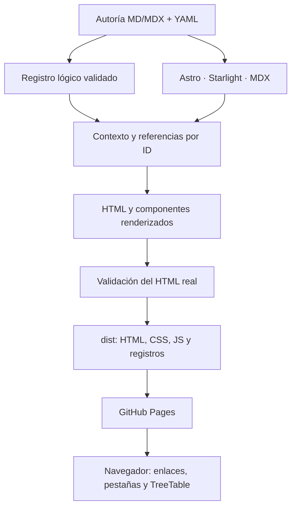
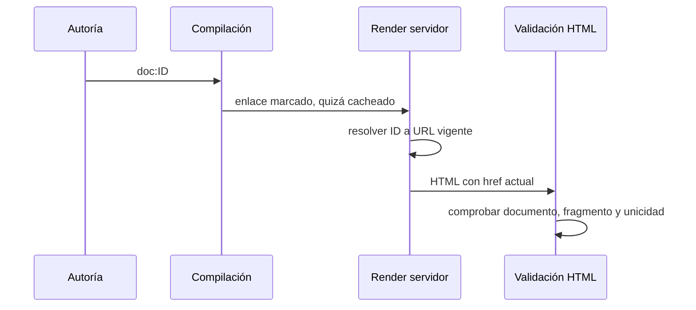

# Arquitectura completa de AstroXmind

Estado comprobado el 18-11-2026 sobre main `673482972c81e17438f6aa1ed77442ad99db0f2d`, publicado en GitHub Pages. Incluye orden opcional, fechas YAML y numeración consecutiva. Evolución en [historia](18-development-history.md), instalación en [manual](10-manual-reconstruccion.md) y evidencia actual en [auditoría](audits/2026-11-18-application-state.md).

## 1. Propósito y límites del sistema

AstroXmind es una wiki técnica para representar y estudiar contenido jerárquico con Markdown/MDX y componentes Astro. Actualmente publica diez documentos técnicos/de prueba. Incorpora tablas árbol, estilos por nivel/nodo, plegado, numeración, demostraciones Resultado/Código y navegación documental por identidad estable.

La producción es un conjunto de archivos estáticos en GitHub Pages. Astro y Node se ejecutan al compilar y durante desarrollo; no hay servidor Node de aplicación atendiendo solicitudes en producción. No hay base de datos, API de edición, autenticación, persistencia remota de cambios ni conversor XMind activo. La configuración tiene un único locale raíz español. No se ha incorporado ClientRouter ni React/Vue.

Hay dos aplicaciones npm, con instalaciones y lockfiles independientes: wiki raíz y laboratorio en examples/astro-component-lab. Comparten el archivo TreeTable.astro mediante imports relativos; no son npm workspaces ni un paquete de componentes publicado. El laboratorio no tiene tsconfig propio: su comprobación de tipos puede alcanzar archivos raíz; se valida tras preparar la raíz y queda pendiente aislar ese análisis.

## 2. Mapa de capas



La estructura editorial y sus referencias se resuelven con código servidor/build. El navegador recibe HTML navegable y JavaScript para interacción; no necesita descargar navigation.json para montar el árbol.

## 3. Inventario de responsabilidades

| Ubicación | Responsabilidad | Clasificación |
|---|---|---|
| package.json / package-lock.json | Scripts y dependencias de la wiki | Fuente de instalación raíz |
| astro.config.mjs | site/base, integraciones, plugins y overrides Starlight | Configuración activa |
| src/content.config.ts | Colección docs, docsLoader/docsSchema y validación navigation | Activo |
| src/content/docs/ | Diez páginas MD/MDX con identidad editorial | Autoría publicada |
| src/components/ | ComponentExample, DocLink, DocumentNavigator y overrides | UI compartida de wiki |
| src/components/examples/Panel.astro | Componente didáctico utilizado por la guía | Demo, no motor de navegación |
| src/examples/ | Ejemplos importables y sus fuentes ?raw | Demos, no páginas del árbol |
| src/lib/navigation/ | Árbol, contexto, referencias y cliente de revelado | Dominio y adaptadores activos |
| src/navigation-middleware.ts | Contexto por página en Starlight | Servidor/build |
| scripts/navigation*.mjs | Lectura YAML, reserva de IDs e integración Astro | CLI y build activos |
| scripts/remark-document-references.mjs | Enlaces Markdown documentales | Compilación activa |
| scripts/reference-validation.mjs | Destinos reales y registro de referencias | Cierre de build |
| navigation-ids.json | Registro permanente de IDs emitidos | Fuente editorial versionada |
| examples/astro-component-lab/ | Aplicación Astro mínima independiente | Desarrollo y demostración |
| examples/astro-component-lab/src/components/TreeTable.astro | Única implementación del componente de tabla | Wiki y laboratorio |
| examples/astro-component-lab/src/styles/article-example.css | CSS global de clases semánticas de demostración | Importado donde se necesita |
| examples/xmind/ | Markdown, .xmind y JSON de referencia | Fixtures documentales, no conversión activa |
| tests/ | Pruebas de árbol, referencias, HTML, DOM y reconstrucción | Verificación |
| docs/ | Arquitectura, contratos, decisiones, continuidad y auditorías | Mantenimiento; fuera del árbol público |
| .github/workflows/ | CI, artefactos, Pages y auditorías/índices | Automatización externa |
| .devcontainer/devcontainer.json | Entorno Codespaces Node 22 y puerto 4321 | Auxiliar; contiene mensaje heredado |
| dist/ / .astro/ / node_modules/ | Salida, caché y paquetes instalados | Generados; no fuente editable |

## 4. Dependencias y decisiones de configuración

Versiones efectivas del lockfile auditado, no equivalentes a los rangos permitidos por package.json:

| Paquete | Versión raíz bloqueada | Uso |
|---|---|---|
| astro | 5.18.2 | Compilación estática y servidor local |
| @astrojs/starlight | 0.36.3 | Documentación, estructura de página, búsqueda y componentes |
| @astrojs/mdx | 4.3.14 | Imports, componentes Astro y Markdown en MDX |
| node-html-parser | 9.0.7 | Lectura/transformación de HTML servidor y validación |
| yaml | 2.9.1 | Frontmatter y registro documental |
| remark-directive | 4.0.0 | Dependencia conservada de prototipos; no conectada al pipeline actual |
| @astrojs/check | 0.9.12 | Comprobación estática, desarrollo |
| typescript | 5.9.3 | Tipos y diagnósticos, desarrollo |
| jsdom | 26.1.0 | Pruebas DOM; no código de cliente |

CI utiliza Node.js 22 y npm ci. Ambos lockfiles son versión 3. El laboratorio tiene Astro/MDX/node-html-parser y herramientas de comprobación, sin Starlight ni jsdom como dependencias directas. No se actualizan versiones para reconstruir: npm ci reproduce el lockfile.

astro.config.mjs establece site=https://pablogonzalezruiz.github.io y base=/AstroXmind. Mantener la base al generar enlaces y recursos; las incidencias iniciales de 404 demostraron que omitirla rompe enlaces aunque exista index.html. Cambiar repositorio o alojamiento requiere revisar site/base y comprobar rutas.

MDX configura extendMarkdownConfig=false, por lo que el plugin de referencias se registra tanto en markdown.remarkPlugins como explícitamente en mdx({ remarkPlugins }). Eliminar una de esas conexiones puede dejar MD o MDX sin resolver.

Starlight aporta Pagefind durante el build y sitemap. Son infraestructura del sitio; no equivalen al buscador avanzado de estudio previsto. EditLink apunta a GitHub main, no a un editor con persistencia dentro de la wiki.

## 5. Modelo documental: carpeta, identidad y pertenencia

Cada página lleva navigation.id y parent; order es opcional en la ampliación de navegación, al igual que created/modified del YAML. El ID de autoría doc-000001 es distinto del ID/slug generado por Astro y de las claves internas de una celda. Las rutas físicas determinan la URL actual; parent/order determinan el árbol lógico. Una referencia cruzada no crea parentesco.

```yaml
navigation:
  id: doc-000007
  parent: doc-000006
  order: 10
```

navigation-ids.json reserva IDs monotónicos de seis cifras. npm run navigation:id reserva el siguiente mediante bloqueo exclusivo y sustitución del registro por archivo temporal; no crea la página. No reutilizar IDs retirados. Dos ramas pueden reservar el mismo siguiente ID por separado: resolver esa colisión antes de integrar, sin renumerar páginas publicadas.

loadNavigation recorre src/content/docs, admite las extensiones documentales del loader, omite archivos cuyo nombre empieza por _, rechaza symlinks y YAML con claves duplicadas, exige IDs reservados y deriva URLs con base/slug/formato. No indexa docs/ ni src/examples/ como documentos.

buildNavigationIndex valida metadatos, IDs duplicados, una única raíz, padres existentes, autociclos/ciclos, rutas públicas duplicadas y dependencia de un padre borrador. Valida también borradores, pero los omite del registro público. Orden de hermanos: primero order explícito, después los que lo omiten; empates y pendientes por created/modified declaradas en YAML con milisegundos, finalmente ID. Ninguna fecha del filesystem, Git o del ledger interviene. Recorrido: preorden global.

Salida inmutable consultable:

```js
{
  schemaVersion: 2,
  rootId: 'doc-000001',
  nodes: { /* ID → id, parent, order, created, modified, sortDate, title, url, children, ancestors, numberPath, numberLabel, pendingOrder */ },
  traversal: [/* IDs en preorden */]
}
```

APIs de index.mjs: buildNavigationIndex, validateNavigation, getNode, getParent, getChildren, getAncestors y getDescendants. context.mjs añade current, breadcrumbs, parent, children, previous y next. El anterior/siguiente es global, no solo entre hermanos; no hay bucle en los extremos.

### Árbol actualmente publicado

| ID | Documento/fuente | Padre |
|---|---|---|
| doc-000001 | index.mdx · Inicio | null |
| doc-000002 | clases-astro.mdx | doc-000001 |
| doc-000003 | componentes/tree-table.mdx | doc-000002 |
| doc-000004 | laboratorio-componentes.md | doc-000001 |
| doc-000010 | navegacion.mdx | doc-000001 |
| doc-000005 | pruebas-jerarquia/serie.md | doc-000010 |
| doc-000006 | pruebas-jerarquia/articulo-1.md | doc-000005 |
| doc-000007 | pruebas-jerarquia/articulo-2.md | doc-000006 |
| doc-000008 | pruebas-jerarquia/articulo-3.md | doc-000007 |
| doc-000009 | pruebas-jerarquia/articulo-4.md | doc-000005 |

Todos los archivos de la serie están directamente en la misma carpeta. Cambiar el parent del Artículo 2 a doc-000009 mueve su rama completa bajo Artículo 4, sin mover archivos, cambiar IDs/URLs ni editar el padre del Artículo 3. El build rechazará moverlo bajo un descendiente.

## 6. Integración Astro y contexto Starlight

navigation-integration.mjs registra un plugin Vite con el módulo virtual virtual:astroxmind/navigation. Su función getNavigationIndex invoca el mismo lector de fuentes usando root/base/trailingSlash/formato resueltos por Astro. Lee al renderizar: no mantiene un segundo árbol editable ni obliga a servir un JSON al navegador.

En astro:build:start se valida el índice. En astro:build:done se comprueba la existencia del HTML de cada ruta, se leen los documentos generados, se validan referencias y se escriben navigation.json y references.json. Saltarse npm run check no evita esta validación de build.

El middleware Starlight obtiene navigation.id de la página y añade Astro.locals.documentNavigation. La portada splash también muestra sidebar. Las páginas técnicas sin identidad, como 404, no reciben un contexto documental falso. Los borradores fuera del índice público no tienen navegador documental.

| Override/componente | Comportamiento |
|---|---|
| PageTitle / Hero | Conservan los componentes Starlight y añaden Breadcrumbs arriba |
| Breadcrumbs | Antecesores y página actual; enlace para subir |
| Sidebar / TreeBranch | Árbol completo de listas anidadas, ubicación actual y footer móvil |
| Pagination | Inserta DocumentNavigator al pie con showTree=false |
| DocumentNavigator | Ubicación, padre, hermanos, hijos y recorrido; árbol completo opcional en details |
| MarkdownContent | Resuelve referencias sobre el HTML final del slot, preservando wrapper Starlight |
| Head | Conserva Head de Starlight e instala el cliente de referencias/estilo de destino |
| DocLink | Referencia MDX por identidad, con slot o título del documento como texto |

DocumentNavigator no necesita props obligatorias: depende del contexto suministrado por el middleware. showTree=true es el valor por defecto; al pie se desactiva porque ya existe el árbol lateral. Es un componente reutilizable dentro del proyecto, no una biblioteca independiente publicada. Las regiones de navegación se excluyen de Pagefind para no repetir títulos ajenos en cada documento.

## 7. Referencias estables y problema de caché resuelto

Sintaxis de autoría:

```md
[Desarrollo](doc:doc-000007#ref-desarrollo)
```

El documento se identifica por ID y el destino local por un ID explícito ref-nombre. Para apartados se usa HTML con id; para TreeTable, [id=ref-nombre]. Los slugs automáticos de títulos siguen disponibles como enlaces nativos, pero no ofrecen el contrato de identidad estable NAV-03. El mismo fragmento puede existir en documentos diferentes, no dos veces en la misma página.

Remark transforma enlaces reales inline/por definición y añade data-doc-reference; no interpreta código mostrado. DocLink produce la misma marca desde componentes MDX. Un <a href="doc:..."> arbitrario no se transforma y el build lo rechaza. Los enlaces inline dentro de TreeTable conservan la marca después del saneado.



Astro Content Layer puede cachear HTML Markdown con una URL antigua. Por ello rendered-references.mjs vuelve a resolver las marcas durante el render de MarkdownContent, usando el índice actual. Resolver solo en Remark era insuficiente: una prueba de renombrado lo detectó. La regresión de dos builds con caché prueba la solución sin borrar caché.

reference-validation.mjs recorre el HTML real de todas las páginas y rechaza IDs duplicados, formato semántico inválido, destinos inexistentes, referencias no resueltas o href divergente. Registra cada referencia renderizada como source/target/fragment/href. references.json v2 añade el ID de cita y su contexto. El build genera los backlinks. Véase la [guía del runtime](24-navigation-runtime.md).

## 8. TreeTable: render servidor y comportamiento de cliente

La implementación única recibe una lista Markdown convertida a HTML en el slot. Exige exactamente una lista raíz y nodos con contenido. Lee el sufijo de anotaciones en texto final, mantiene código inline como literal y permite un subconjunto de HTML inline/enlaces; no ejecuta nombres de clase como expresiones.

Pipeline interno: parseList → opciones por nodo → numeración y clases → herencia de collapsible/folded → claves/padres internos → profundidad/hojas → celdas con rowspan/colspan → HTML de tabla completo. La profundidad raíz es 0. El número de hojas determina las filas; las hojas pueden extenderse por columnas restantes.

| Propiedad | Contrato |
|---|---|
| numbering del componente | none/siblings/path; controla presentación, no activa por sí solo cada nodo |
| numbering de nodo | arabic/none, heredable; none corta la ruta acumulada |
| tiered | Heredable; ruta gradual cuando corresponde |
| start | Local al nodo; cada grupo comienza en 1 y sus hermanos numerados continúan |
| collapsible | Capacidad heredable; por defecto false; hojas sin botón |
| folded | Estado inicial heredable; por defecto false; un nodo no plegable queda abierto |
| levelClasses / class | Explícita > nivel > padre > estilo predeterminado; class=none corta clase heredada |
| id | ref-nombre opcional, local al documento y no heredable |

El custom element astro-xmind-tree-table captura las celdas, construye relaciones padre/hijos y conserva un Set de claves plegadas. Redibuja moviendo las mismas celdas y recalculando geometría; las celdas cerradas pueden quedar desprendidas del DOM. El estado permanece en memoria de esa instancia: no hay guardado entre sesiones.

revealTarget(id) busca también celdas desprendidas y abre solo sus antecesores; conserva ramas ajenas y el plegado del propio destino. No confundir id editorial de celda con data-tree-key, que es una clave interna por render.

El botón de plegado es pequeño y absoluto arriba a la izquierda. Fullscreen ofrece botón contextual, API nativa o alternativa de viewport, Escape/salida y restauración de foco; en la alternativa contiene el foco. Auto margins centran solo cuando sobra espacio; el overflow conserva accesible el origen. No guarda en backend el estado de pantalla completa.

Sin JavaScript se renderiza la tabla completa y se ocultan botones inactivos. Al activar JavaScript se aplica folded. El parser toma la primera sublista por nodo; revisar listas múltiples en robustez, no prometer compatibilidad con cualquier Markdown arbitrario.

## 9. Cliente de navegación por fragmento

reference-client.mjs atiende entrada inicial, hashchange y repetición del mismo hash mediante enlace. Acepta solo destinos ref-nombre; hashes nativos normales conservan el comportamiento del navegador. Espera los custom elements, pide a TreeTable revelar celdas cerradas, activa el panel Starlight que contiene el destino y abre details antecesores. Después desplaza, enfoca y aplica reference-destination.

No intercepta clics modificados, descargas o apertura en otra pestaña. El resaltado se sustituye al consultar otro destino explícito. NAV-05 usa historial de sesión para restaurar scroll, foco, pestañas y plegado al volver al origen.

## 10. Ejemplos, CSS y fuente única

ComponentExample utiliza Tabs/TabItem/Code de Starlight. Cada demo MDX se importa una vez como componente y otra como ?raw; Resultado muestra el componente y Código muestra esa misma fuente. Hay catorce demostraciones: ocho de TreeTable, tres de guía y tres de Navegación. Los archivos de ejemplo no son nuevos documentos del árbol ni los ejemplos raw nuevas citas.

Las clases nivel-N describen profundidad. Las clases ArticuloCabecera/ArticuloPunto son ejemplos, no palabras reservadas; necesitan CSS global importado. El CSS encapsulado de Astro no sustituye automáticamente la hoja global para contenido generado dinámicamente.

StackBlitz abre una copia del laboratorio; no sincroniza cambios con GitHub ni constituye un editor persistente de la wiki. Los fixtures XMind ayudan a observar estructura/estilos, pero no cargan el visor oficial como dependencia del componente ni generan .xmind.

## 11. CI/CD, búsqueda y límites de confianza

El código se almacena en GitHub; Pages publica dist. No hay secretos necesarios para el build de contenido. El entorno github-pages y los permisos de Actions controlan el despliegue, no un login de lectura de la wiki. GitHub/historial y las páginas actuales son públicos.

CI ejecuta instalación bloqueada, check y build. Wiki Build produce el artefacto astro-xmind-site; Pages vuelve a construir y sube un artefacto propio, verificando rutas técnicas y ausencia de salidas antiguas. El deploy usa needs:build; no está condicionado mediante needs al workflow CI independiente. Consultar ambos antes de comunicar éxito. Los índices de runs se escriben en ramas automation/seguridad, separados de main.

La auditoría de dependencias es informativa: captura npm audit aunque tenga código de salida no cero y resume metadatos de licencia del lockfile raíz. Un resultado verde acredita que el informe se generó, no cero vulnerabilidades, conformidad de licencias ni revisión automática del lockfile del laboratorio. [Operación detallada](19-operations-and-verification.md).

## 12. Código heredado y evolución futura

Scripts remark-semantic, rehype-tree-table, render-semantic, render-pandoc y render-tree-table; fuentes src/semantic, src/pandoc y src/tree-tables: prototipos conservados, no conectados a los scripts activos de build/configuración. Ejecutarlos manualmente puede generar otras salidas; no son pasos necesarios para instalar el estado actual. Pandoc y Tabulator no son dependencias de la wiki actual.

NAV-04 a NAV-07 están publicados. NAV-08 se integra en main tras validación en Windows. Summary/Boundary, exportación .xmind, editor persistente y biblioteca distribuible siguen pendientes.

Puntos de revisión futuros: coste de releer el árbol en cada render, árboles muy profundos/grandes, ámbitos multilingües, colisiones de reservas entre ramas, anclas al ensamblar documentos, pruebas visuales/móvil/teclado. Son límites conocidos, no capacidades ya verificadas. No retirar la validación HTML para ocultar fallos de rutas o referencias.

## Ampliación publicada de ordenación

[Orden opcional y numeración](20-navigation-ordering.md): NavigationLabel centraliza números heredados y marcas de pendientes en árbol/migas/DocumentNavigator. created y modified solo existen si se declaran en navigation; requieren milisegundos y zona. No hay timestamps implícitos ni cambio en el generador de IDs. schemaVersion del índice pasa a 2. El producto está publicado en f3e2259, incluida la corrección de ordinales consecutivos por grupos de order.
