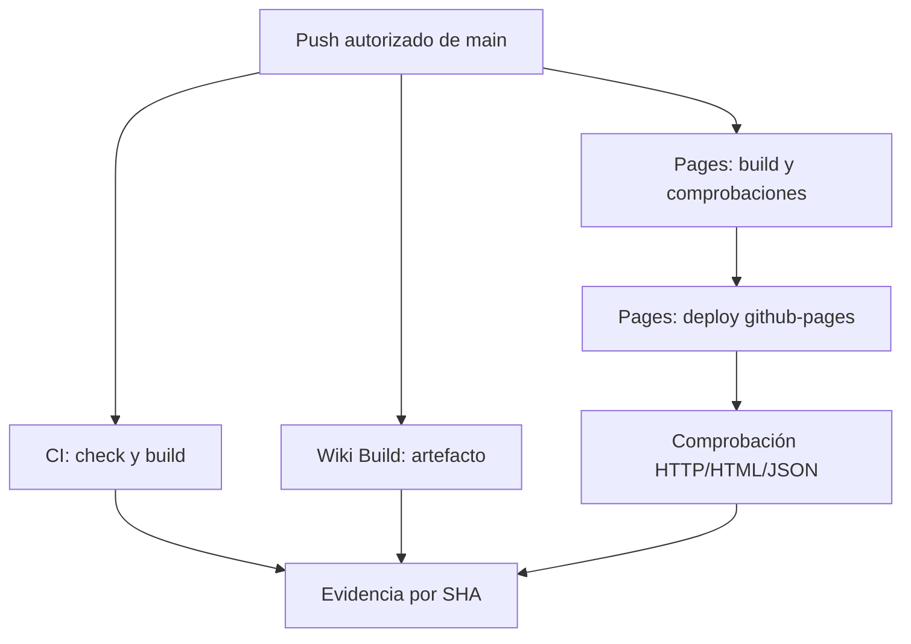

# Operación, pruebas, CI/CD y recuperación

Referencia: main publicado 2cdba361920b58a5002faa063e46660f22ff36ef, contrastado el 17-11-2026. [Instalación limpia](10-manual-reconstruccion.md), [arquitectura](02-architecture.md) e [historia](18-development-history.md).

## 1. Comandos y alcance real

| Comando raíz | Qué hace | Qué no demuestra |
|---|---|---|
| npm ci | Instala exactamente el lockfile, incluidas herramientas de desarrollo | No actualiza ni corrige avisos por sí mismo |
| npm run navigation:check | Reconstruye/valida árbol y muestra preorden | No valida fragmentos del HTML renderizado |
| npm run navigation:id | Reserva un ID en el ledger | No crea una página; sí modifica una fuente versionada |
| npm run test:navigation | 32 pruebas de navegación/referencias en la revisión | No renderiza páginas en navegador real |
| npm run check | Árbol + pruebas anteriores + astro check | No despliega |
| npm run build | Astro build, validación de HTML/registro y 15 pruebas HTML/DOM | No ejecuta automáticamente test:references:rebuild |
| npm run test:references:rebuild | Prueba adicional de dos builds con caché/renombrado en copia temporal | No mueve los archivos del checkout de trabajo |
| npm run dev | Servidor local con actualización de fuentes | No publica ni guarda cambios de usuarios remotos |
| npm run preview | Sirve dist para inspección local | No reconstruye dist ni despliega |

La raíz completa suma 48 pruebas al ejecutar check, build y la reconstrucción adicional. CI habitual suma 47 porque no incluye el comando adicional. No describir las pruebas DOM como capturas visuales o validación de dispositivos.

## 2. Instalación raíz y laboratorio

Son dos paquetes con lockfiles independientes. Preparar/verificar primero la raíz y después el laboratorio, según el manual. Se reejecutó esta secuencia durante la auditoría documental.

Se observó un fallo al correr el check del laboratorio mientras la raíz todavía se preparaba en paralelo: alcanzó ../../src/navigation-middleware.ts y señaló que starlightRoute no existía en App.Locals. Tras terminar la preparación/comprobación de la raíz, el mismo check del laboratorio pasó (40 archivos) y su build generó una página.

No hay tsconfig propio versionado en el laboratorio: la comprobación de tipos puede alcanzar configuración/archivos de la raíz. La independencia npm no implica aislamiento completo del análisis TypeScript. Queda una mejora de aislamiento dentro de robustez; no se ha cambiado código para ocultar el hallazgo. No prometer un check autónomo en carpeta mínima/StackBlitz sin comprobar ese entorno.

## 3. Workflows existentes

| Archivo | Disparador/ámbito | Salida y permisos relevantes |
|---|---|---|
| ci.yml | push a main/test/remark-directive, PR y manual | Node 22, lockfile, npm ci, check/build y entrada generada; contents:read |
| wiki-ci.yml | main, PR y manual | Build y artefacto astro-xmind-site; contents:read |
| wiki-pages.yml | main y manual | Build, comprobación de rutas, artefacto Pages y deploy; pages:write/id-token:write, contents:read |
| ci-run-index.yml | workflow_run de CI completado, push en main | Escribe ci/latest-run.json en automation/ci-run-index; contents:write |
| dependency-audit.yml | main cuando cambian dependencias/script/workflow, o manual | npm audit + resumen Python, artefacto ast-003-5-dependency-audit; contents:read |
| dependency-audit-index.yml | Auditoría completada en main | Índice en automation/ci-run-index; contents:write |
| security-upgrade-candidate.yml | Rama security/ast-003-5-dependency-upgrade y manual | Validación de candidata; puede versionar su lockfile en esa rama |
| security-upgrade-run-index.yml | Validación candidata completada en rama de seguridad | Índice en automation/ci-run-index; contents:write |

No ejecutar la candidata de seguridad ni fusionar su PR como efecto secundario de documentar. Los índices son una ayuda para localizar runs, no sustituyen consultar resultado/SHA de la ejecución real. No añadir sondeos periódicos/automatizaciones si no se han pedido.

## 4. Pipeline de publicación

Los tres workflows son independientes. Pages deploy depende de su propio build, no de la conclusión de CI en otro workflow. Verificar ambos; no afirmar que CI aprobó antes de desplegar salvo que se haya comprobado esa secuencia.

Pages verifica las cuatro rutas técnicas originales y ausencia de antiguas salidas tabulator/markmap/bloque-1. El registro de navegación y las pruebas de build validan también las nuevas páginas. Pagefind y sitemap se generan durante build. El artefacto de Wiki Build y el de Pages no son una release.

El alojamiento es público. No hay login ni restricción de lectura por hacer privado otro documento. docs/ no se publica como páginas de la wiki, pero está en el repositorio público. Los cambios en main pueden activar despliegue: requieren aprobación aplicable.

## 5. Evidencia de la versión actual

| Evidencia | SHA y resultado |
|---|---|
| [CI 44096661054](https://github.com/PabloGonzalezRuiz/AstroXmind/actions/runs/44096661054) | 2cdba36 · completed/success |
| [Wiki Build 44096660778](https://github.com/PabloGonzalezRuiz/AstroXmind/actions/runs/44096660778) | 2cdba36 · completed/success |
| [Pages 44096660802](https://github.com/PabloGonzalezRuiz/AstroXmind/actions/runs/44096660802) | 2cdba36 · completed/success |
| [Auditoría 44096660856](https://github.com/PabloGonzalezRuiz/AstroXmind/actions/runs/44096660856) | 2cdba36 · informe generado correctamente; no certifica cero avisos |
| HTTP/HTML publicados | Diez páginas 200; catorce referencias, fragmentos y estructura verificados |

[Demostración](https://pablogonzalezruiz.github.io/AstroXmind/navegacion/), [serie](https://pablogonzalezruiz.github.io/AstroXmind/pruebas-jerarquia/serie/), [navigation.json](https://pablogonzalezruiz.github.io/AstroXmind/navigation.json), [references.json](https://pablogonzalezruiz.github.io/AstroXmind/references.json).

Esta tabla corresponde a ese SHA; al avanzar main, consultar nuevas ejecuciones. No reutilizar un run verde de una versión anterior como evidencia del cambio nuevo.

## 6. Auditoría y límites de cobertura

El workflow raíz captura npm audit --json aunque informe vulnerabilidades. El script Python cuenta metadatos del lockfile raíz y escribe report.md; no resuelve dependencias ni hace revisión legal. El lockfile del laboratorio necesita revisión separada. La raíz no tiene un archivo LICENSE versionado ni campo license en package.json en la revisión auditada: conservarlo como punto de inventario por consolidar antes de distribuir, sin declarar que el informe ya lo certificó.

Las pruebas comprueban árbol, orden, ciclos, borradores, IDs, rutas, reservas, enlaces/fragmentos, código raw excluido, HTML final y DOM de celdas/pestañas/foco. Los builds negativos anteriores comprobaron destino eliminado, ID repetido e ID de tabla repetido, restaurando después las fuentes.

jsdom ejecuta los bundles compilados reales de TreeTable/Starlight Tabs, pero no tiene layout real. La prueba de reconstrucción copia fuentes a un temporal y enlaza node_modules, conserva caché entre builds y renombra solo el documento destino. Los paquetes de prueba no se envían como aplicación de cliente.

Pendiente de revisión visual completa: móvil/táctil, navegación por teclado, scroll real de tablas grandes, fullscreen nativo y tamaños extremos. Chromium no pudo arrancar en la validación previa por restricciones del entorno; no atribuir a DOM una cobertura de navegador que no existe.

## 7. Recuperación y diagnóstico

Trabajar desde un checkout limpio de SHA, sin reset destructivo del trabajo del usuario. dist y caché son regenerables; fuentes, ledger y lockfiles son la base reproducible. No editar navigation.json/references.json generados para corregir una fuente inválida.

Cuando falla build: leer el primer error relevante, contrastar frontmatter/IDs/imports/base, corregir la fuente dentro del alcance autorizado y repetir solo las comprobaciones afectadas. No desactivar validación para que pase ni activar prototipos viejos por accidente. Ante diferencia de ruta cacheada, mantener la resolución de MarkdownContent y su regresión.

Un rollback remoto modifica main y despliega de nuevo: necesita autorización explícita. El respaldo a4ea186 es histórico; el punto reproducible actual es 2cdba36. Conservar ramas/PR antiguos y auditorías salvo instrucción expresa. Para publicación de una corrección, crear resultado revisable en rama, mostrar evidencia y solicitar aprobación si todavía no existe.
