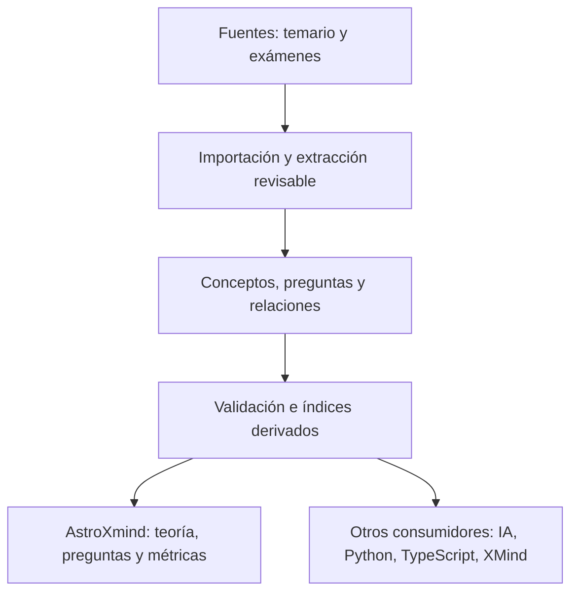

# KNOW-01 · Modelo declarativo y arquitectura

**Actualización:** propuesta inicial; prevalece la [arquitectura maestra v0.9](AstroXmind-Arquitectura-Maestra.md). Incorporar oposición, versión del programa, convocatoria, examen, nodo del programa, concepto, ocurrencia de pregunta, plantilla versionada, perfil de evaluación, fuente/artefacto y correspondencia histórica. Fase 01 diseña programas versionados antes del contrato común de Fase 02; el ejemplo sintético permanece como fixture posterior.

## Separar tres capas



La capa de conocimiento no depende del renderizador ni del árbol de Starlight. MD/YAML para autoría y datos declarativos; JSON derivado para intercambio, consumo y búsquedas. La ubicación y esquema definitivos se deciden en KNOW-01; ningún archivo de ejecución se crea en este encargo.

## Identidad y relaciones

| Entidad | Identidad | Responsabilidad |
|---|---|---|
| Concepto | `concept_id` estable; ejemplo `dns` | Unidad de conocimiento, título, alias, descripción y fuentes |
| Documento | `navigation.id` existente, `doc-000XXX` | Página o destino que representa teoría; no sustituir sus IDs ni su registro |
| Pregunta | `question_id` estable | Enunciado, opciones, respuesta, tipo y referencias a conceptos |
| Examen | `exam_id` estable | Organismo, convocatoria, fecha, ejercicio, versión y procedencia |
| Relación | Origen/destino/tipo | Relación dirigida entre conceptos o entre pregunta y concepto |

Un concepto puede disponerse en un documento propio o referenciar un ancla estable de un documento; se decidirá granularidad editorial sin confundir concepto con página. El árbol `navigation.parent` sigue teniendo un solo padre; las relaciones semánticas son una red muchos a muchos y no modifican el árbol. Mantener identidad cuando se cambia título, archivo o URL.

Ejemplo conceptual ilustrativo, no datos oficiales ni contrato definitivo:

```yaml
concept_id: dns
title: DNS
type: concept
aliases: [Domain Name System]
related:
  - target: udp
    type: related
  - target: ipv4
    type: related
```

```yaml
question_id: demo-dns-001
type: example-question
prompt: ¿Qué servicio permite resolver nombres de dominio?
options:
  - id: A
    text: DNS
  - id: B
    text: DHCP
correct_answer: A
concepts:
  - id: dns
    role: assessed
  - id: dhcp
    role: distractor
```

Roles propuestos: `assessed` (evaluado), `related` (necesario para comprender la respuesta), `distractor` (alternativa incorrecta o elemento de distracción), `mentioned` (mención incidental). La lista definitiva se valida en KNOW-01; los roles evitan que distractores inflen la frecuencia examinada. Una pregunta puede evaluar varios conceptos. La relación inversa se deriva y no se edita por separado. La relación entre conceptos puede ser simétrica o dirigida según su tipo.

## Fuentes y revisión

- Preguntas oficiales deben identificar examen, enunciado original, número/versión, opciones, respuesta de la plantilla oficial y estado (vigente/anulada/rectificada), fuente y fecha de revisión. No inferir una respuesta oficial a partir de la IA. Separar transcripción de adaptación.
- La extracción PDF/DOCX/MD debe conservar fuente y localización, producir candidatos revisables, resolver alias y duplicados, y registrar incertidumbre. No inventar páginas ni fechas. Importaciones repetidas deben ser idempotentes.
- Vinculaciones de IA: guardar evidencia de texto, procedencia y estado de revisión cuando corresponda. Distinguir propuesta de enlace confirmado; decidir umbrales y revisión humana más adelante.
- Validar tipos, IDs únicos y referencias existentes; rechazar relaciones desconocidas, respuestas inválidas y ciclos de pertenencia jerárquica. No prohibir ciclos semánticos legítimos.
- Mantener corpus, licencia/acceso y tratamiento de datos personales explícitos antes de publicar material externo. No introducir temario real ni copiar exámenes sin confirmar su fuente y condiciones.

## Reutilización de AstroXmind

Se reutilizan `navigation.id`, `navigation-ids.json`, DocLink, destinos `ref-*`, árbol y backlinks, grafo, TreeTable, editor y FrameEjemplo. Las referencias `doc:` enlazan páginas y anclas; no son por sí solas el índice semántico tipado. KNOW-02 diseñará un registro derivado de conocimiento adicional, sin convertir navegación en un grafo de pertenencia múltiple. KNOW-05 expondrá las relaciones en la wiki. No romper el hito funcional.
