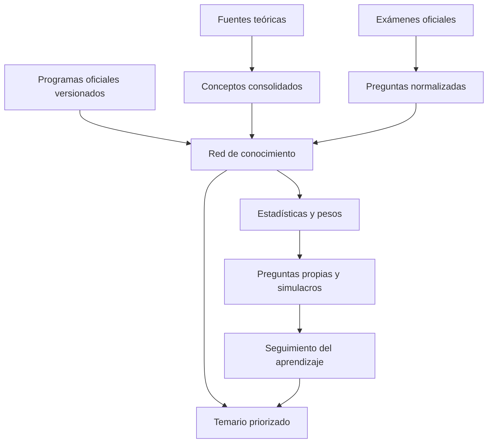
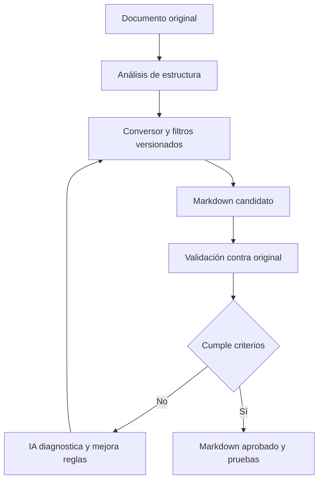

# AstroXmind — Arquitectura y hoja de ruta maestra

**Versión de diseño:** 0.9 · 22 de noviembre de 2026

## 1. Visión

Construir un sistema de preparación de oposiciones que convierta fuentes dispersas, programas oficiales y exámenes históricos en conocimiento estructurado y material de estudio priorizado. TAI será la primera oposición; el modelo deberá permitir otras oposiciones sin duplicar conceptos comunes.

## 2. Cuatro pilares

| Pilar | Entrada | Resultado |
|---|---|---|
| A. Estructura oficial | Convocatorias y programas por edición | Árboles versionados de bloques, temas y epígrafes |
| B. Conocimiento | PDF, DOCX, Excel, MD y otras fuentes | Conceptos atomizados, consolidados y trazables |
| C. Exámenes oficiales | Cuadernillos, plantillas y correcciones | Preguntas clasificadas y vinculadas al conocimiento |
| D. Exámenes propios | Conceptos, pesos y patrones oficiales | Preguntas revisadas y simulacros ponderados |



## 3. Pilar A: estructura oficial y evolución temporal

Es el primer pilar que se debe diseñar. Deben coexistir las estructuras de todas las convocatorias, aunque la edición objetivo de estudio sea normalmente la más reciente disponible.

Separar las entidades `opposition`, `syllabus_version`, `call`, `exam`, `syllabus_node` y `concept`. Una convocatoria referencia la versión exacta del programa que la rige; varias convocatorias pueden compartir una versión. Una fecha de examen no equivale necesariamente al año de convocatoria.

Cada árbol oficial conserva el texto, orden, jerarquía, fuente y vigencia originales. Los conceptos son independientes de los árboles: una misma unidad de conocimiento puede pertenecer a diferentes temas, ediciones u oposiciones sin copiar su contenido.

### Ficha completa de convocatoria: campos de extracción

#### Identificación automática y nomenclatura N0 → N1

Patrón canónico: `AAAA-MM-DD_CUERPO_MODALIDAD_TIPO_REFERENCIA[_ALCANCE]__FASE.ext`. Usar mayúsculas ASCII, guiones dentro de fechas y referencias, guiones bajos entre campos; extensiones en minúscula. El doble guion bajo separa la identidad documental estable de la fase derivada. La fecha al comienzo es la publicación oficial, nunca el año de la OEP o del examen. Estos últimos se extraen y guardan por separado en los metadatos. No usar el nombre original como evidencia.

| Fase documental | Sufijo | Contenido y política |
|---|---|---|
| F00 | `F00-ORIGINAL.pdf` | Original inmutable |
| F01 | `F01-TRANSCRIPCION.md` | Transcripción completa, incluso elementos repetidos, con referencia a páginas |
| F02 | `F02-LIMPIO.md` | Markdown fiel; elimina solo ruido de maquetación y repeticiones identificadas, reconstruye estructura |
| F03 | `F03-SELECCION.md` | Selección de secciones relevantes, conserva literal protegido |
| F04 | `F04-RESUMEN.md` | Resumen explícitamente derivado, con secciones protegidas íntegras o enlazadas como requisito de cobertura |
| F05 | `F05-ESTRUCTURADO.yaml` | Ficha de campos, jerarquía, reglas y procedencia |

Estas fases documentales F00–F05 son distintas de los niveles N del corpus de conocimiento: F00=N0, F01/F02 corresponden a la conversión N1, F03–F05 son derivados orientados al expediente de convocatoria y no sustituyen N2/N3. El resumen es opcional; la ficha estructurada debe basarse en la fuente fiel F02 y no depender de un resumen. Cada fase conserva mismo identificador base, `parent_artifact_id`, huella de entrada/salida, versión de conversor y estado. El fichero de metadatos se denomina `<base>__METADATOS.yaml` y cataloga las fases; informe `<base>__F02-VALIDACION.md`. No confundir una rectificación oficial (nueva identidad/referencia) con una nueva ejecución de una fase.

### Secciones protegidas de las convocatorias

Marcar explícitamente el programa oficial y las normas del formato, corrección y evaluación como `retention: mandatory`, `fidelity: verbatim`. Incluir también las cifras de plazas por cupo y las reglas de mínimos, transformación, selección de supuesto, penalización, reservas, anulaciones y desempate. Conservar estos fragmentos completos, con su número de apartado, modalidad, página y texto, en F02 y F03; F04 nunca los sustituye por un resumen: reproduce el fragmento o incorpora una referencia obligatoria a su versión literal, cuya presencia se valida. F05 debe estructurarlos sin perder la referencia al literal. Mantener separadas las reglas iniciales y las publicaciones posteriores de la CPS. Cada fragmento protegido se identifica y registra con hash normalizado y referencias de origen; la validación compara cifras, puntuación, tablas, numeración y texto y bloquea avance si falta un fragmento. Los resúmenes y conceptos derivados pueden coexistir, nunca sobreescribir la evidencia. En 2025 libre los apartados 2 (proceso selectivo y calificación) y 3 (programa), anexo V, son críticos; verificar también el apartado 1 (plazas).

| Campo | Lugar de extracción del PDF | Regla |
|---|---|---|
| Fecha de publicación | Cabecera del BOE: número, día, mes y año | Normalizar a ISO 8601; no confundir con la fecha de la resolución |
| Cuerpo | Título, tabla de cuerpos y encabezamiento del anexo | TAI = Técnicos Auxiliares de Informática; AGE si el documento abarca varios cuerpos |
| Modalidad | Encabezado de normas específicas y denominación de acceso | LIBRE, PROMOCION-INTERNA o GENERAL si contiene varias modalidades |
| Tipo | Título y contenido del documento | CONVOCATORIA, CRITERIOS, CUESTIONARIO, PLANTILLA-DEFINITIVA, PUNTUACIONES-MINIMAS, RECTIFICACION, etc. |
| Referencia | CVE del BOE, normalmente en el margen; o identificador oficial del documento INAP | No inventar referencia; si falta, comprobar la fuente oficial |
| Alcance | Encabezado del anexo, páginas presentes, modelo A/B y carácter ordinario/extraordinario | ANEXO-V, EXTRACTO, MODELO-A, etc., solo cuando corresponda |

Ejemplo confirmado: el PDF de 91 páginas aportado para 2025 contiene la resolución general, múltiples cuerpos y modalidades. Se nombra `2025-12-22_AGE_GENERAL_CONVOCATORIA_BOE-A-2025-26262__F00-ORIGINAL.pdf`. El anexo específico TAI libre publicado por INAP se denomina `2025-12-22_TAI_LIBRE_CONVOCATORIA_BOE-A-2025-26262_ANEXO-V__F00-ORIGINAL.pdf` cuando se dispone de ese original separado. Si extraemos nosotros las páginas del BOE completo, se trata de un derivado con procedencia del original, no un original INAP. Los MD conservan la identidad base y cambian el sufijo de fase; el YAML y el informe de validación comparten esa identidad, sin atribuir a un extracto el contenido de la resolución completa.

Procedimiento determinista: extraer texto por página; identificar cabecera/cve y títulos de anexos; normalizar fecha con diccionario de meses españoles; seleccionar cuerpo/modalidad por alcance real; comprobar coherencia entre campos y validar contra documentos de referencia. Registrar para cada campo `value`, `source_page`, `evidence`, `method`, `status`; aplicar OCR si no existe capa de texto. Cuando un extracto omite cabecera, fecha o CVE, consultar el BOE/INAP original y registrar procedencia externa; si persiste duda, no renombrar automáticamente y dejar el documento pendiente. Conservar nombre recibido, huella SHA-256, URL oficial y páginas de origen. Nunca sobreescribir archivos con distinta huella: registrar colisión y versión o rectificación.

#### Metadatos: original inmutable y ficha acompañante

Leer primero los metadatos internos PDF (Info y XMP), contrastándolos con el texto visible. Prueba real del BOE 2025: `Title` = Disposición 26262 del BOE núm. 306 de 2025, `Subject` = BOE-A-2025-26262, `Keywords` contiene resolución 18/12/2025 y publicación 22/12/2025. La primera página confirma la fecha de publicación y el CVE. La fecha técnica de creación/modificación del PDF es 19/12/2025, por lo que NO sirve como fecha oficial. El alcance TAI libre se identifica en el anexo V; el anexo VI contiene PI.

No modificar el PDF oficial para añadir metadatos: alteraría su huella y podría afectar una firma o certificación. Guardar un fichero acompañante `.yaml` con el mismo nombre base, esquema versionado, identidad estable, fuente, fechas, modalidades, anexo/páginas, nombre original, nombre canónico, huella, idioma, estado y evidencias por campo. El nombre se generará a partir de esa ficha, no al revés. Si se desea un PDF enriquecido para consulta, será una copia derivada claramente identificada, nunca sustituto del original. La ficha separa metadatos nativos, valores extraídos, correcciones y procedencia externa; puede regenerarse de forma determinista. Revisión humana solo para datos contradictorios o imposibles de verificar, no para cada documento.

Guardar URL directa exacta del PDF oficial descargado, URL de ficha INAP y enlace BOE, con fecha de descarga o verificación y estado. No confundir URL de anexo INAP con URL del PDF general BOE; atribuir cada enlace a su alcance real. Si no se descargó desde esa URL, marcar enlace localizado, sin declarar igualdad de bytes hasta comprobar la huella.

#### Fuentes de las reglas de corrección y futuras publicaciones

La Resolución de 18/12/2025 (BOE-A-2025-26262, publicación 22/12/2025) contiene el anexo V, normas específicas TAI libre; el INAP ofrece ese anexo por separado en https://sede.inap.gob.es/sites/sede/files/public/2025-12/TAILI.pdf. No son dos reglas distintas. El apartado 2 describe proceso y corrección: 80 preguntas teóricas, 20 prácticas elegidas entre III/IV, 120 minutos, penalización de un tercio y blancos sin penalizar; 2.3 establece calificación, máximos 50+50, mínimos transformados 25 por parte, transformación y criterios de desempate. El documento complementario CPS de criterios de corrección, valoración y superación fue publicado el 19/05/2026 (https://sede.inap.gob.es/sites/sede/files/public/2026-05/TAI%20LI%202025.pdf); se ha verificado su enlace en la ficha, pero queda pendiente leer y validar íntegramente su PDF. Las plantillas definitivas y el documento de puntuaciones mínimas se publican posteriormente y completan el perfil. No mezclar bases, criterios específicos, plantillas ni resultados definitivos. La ficha de evaluación debe referenciar todos ellos y sus rectificaciones, con precedencia según su autoridad y vigencia.

Preparar en una fase posterior un monitor de publicaciones oficiales (cronogramas CPS, rectificaciones, criterios, convocatorias, plantillas, cortes y resultados), con registro de fecha, URL, huella, tipo, aviso y versiones. No activar alertas ni dedicar trabajo a cronogramas en esta fase: queda como requisito futuro explícito.

Cada expediente en AstroXmind mostrará el árbol original PDF, MD N1, metadatos e informe de validación, con enlaces cruzados y estado. GitHub Actions deberá ejecutar la conversión y controles al añadir/modificar fuentes; publicar únicamente resultados aprobados. No se ha autorizado todavía la publicación en el repositorio público de los archivos aportados.

La primera tarea consiste en estudiar conjuntamente con Pablo la convocatoria más reciente (publicada el 22/12/2025, examen en 2026, ingreso libre general) y acordar qué bloques maestros forman su ficha integral antes de automatizar la conversión. El conversor extraerá después los datos con procedencia por campo (documento, anexo, página, apartado, texto de apoyo y estado de revisión). La ficha referencia varios documentos oficiales, no solo un PDF.

| Sección | Datos relevantes | Prioridad |
|---|---|---|
| Identidad | Cuerpo, código, fecha resolución y publicación, BOE, OEP incluidas, modalidad, cupo, convocatoria/examen | Crítica |
| Plazas | Vacantes iniciales por cupo, rectificaciones, plazas efectivas y adjudicadas | Crítica |
| Programa | Bloques, temas, literal oficial, subtemas derivados, vigencia, alcance | Crítica |
| Formato | Número de ejercicios/partes, preguntas y reservas, tipo de respuesta, elección de supuesto, duración y carácter eliminatorio | Crítica |
| Corrección | Valor del acierto, penalización exacta, blancos, marcas inválidas, sustituciones, agregación y mínimos | Crítica |
| Resultados | Cortes por cupo y parte, transformación, desempates, distribución anonimizada y nota de última plaza | Crítica; se añade después |
| Normativa aplicable | Fecha de referencia de legislación, rectificaciones y cambios de bases | Alta |
| Acceso y proceso | Requisitos, solicitudes, tasas, plazos, conservación de notas, concurso (PI), llamamientos | Secundaria para estudio; conservar si consta |

Registrar por separado lo fijado inicialmente por bases, los criterios posteriores de la CPS y los resultados efectivos. Un valor desconocido es `null` con estado pendiente; nunca inferirlo sin marcar la inferencia. Los datos personales del listado de aspirantes no se incorporan; únicamente estadísticas agregadas. El perfil personal predeterminado es TAI, ingreso libre, cupo general sin discapacidad. Para simulacros nuevos usar perfil de evaluación más reciente validado; históricos por perfil original. Diferenciar superar examen y alcanzar plaza mediante el último adjudicatario del cupo y reglas de desempate; resultado indeterminado si faltan datos.

### Correspondencias entre versiones

Permitir relaciones de equivalencia, renombrado, traslado, división, fusión, inclusión parcial, incorporación y retirada. Admitir correspondencias muchos a muchos, con justificación, confianza y revisión cuando exista ambigüedad. No forzar equivalencias donde no existan.

Ejemplo ilustrativo, no clasificación histórica verificada:

| Pregunta | Clasificación histórica | Proyección de estudio |
|---|---|---|
| TAI, examen de 2000, pregunta 15 | Epígrafe de su programa aplicable | Epígrafe equivalente del programa objetivo |
| TAI, examen de 2016, pregunta 20 | Epígrafe de su programa aplicable | Mismo concepto, si sigue siendo pertinente |
| Pregunta sobre tecnología retirada | Epígrafe histórico | Sin correspondencia o relevancia actual |

Nunca se modifica retroactivamente el programa original. Si una pregunta antigua contiene una respuesta que ha quedado obsoleta por cambios técnicos o legales, conservar la respuesta oficial histórica y añadir una explicación vigente diferenciada.

### Historial de cambios y prioridad por novedad

Cada transición entre programas contendrá eventos `added`, `removed`, `moved`, `renamed`, `modified`, `split`, `merged`, `unchanged` y `uncertain`. Guardar origen y destino, rutas, IDs, edición de referencia, evidencia, fecha, confianza y estado de revisión. Admitir varios cambios simultáneos. La primera edición es línea base, no marcar todo como nuevo respecto de un año desconocido. Distinguir texto no mencionado explícitamente de concepto realmente excluido; no eliminar información hasta comprobar cobertura semántica. Añadir también comparativas de formato, corrección, plazas y mínimos, independientes de los cambios temáticos.

En la vista de estudio vigente, mostrar etiquetas Nuevo, Modificado, Desplazado y Eliminado (este último ocultable; conservar en histórico); las marcas de incertidumbre requieren revisión. La novedad en la última convocatoria añade un factor configurable independiente del peso histórico, que impulsa el estudio y la generación de preguntas de contenidos nuevos o ampliados. Un movimiento puro no aumenta por sí solo la novedad. Propagar la marca a descendientes nuevos sin contar dos veces el mismo concepto; garantizar cobertura de novedades en simulacros sin inventar preguntas históricas, siempre con teoría validada. Validar y calibrar ponderaciones con exámenes de años retenidos, sin asumir que novedad equivale a probabilidad.

### Primera iteración y comparación de prueba

Ya existe un prototipo determinista (PDF → YAML/MD) con ocho programas extraídos de cinco PDF. La referencia de diseño será la convocatoria publicada el 22/12/2025, BOE-A-2025-26262, ingreso libre, anexo V: 4 bloques con 9, 5, 9 y 10 temas. El examen tiene 80 preguntas teóricas y 20 prácticas, cada parte aporta hasta 50 puntos y exige un mínimo independiente. El peso de cada parte en la calificación final debe ser un campo explícito, diferente de la distribución empírica de preguntas por bloque. A continuación se incorporarán retrospectivamente las anteriores, incluidas las modalidades PI en árboles independientes. No confundir año OEP, fecha publicación y fecha examen. En el catálogo oficial se detectó además la OEP 2018 publicada en 2019, distinta de la OEP 2019 convocada en 2021, y debe recuperarse antes de afirmar cambios entre ediciones consecutivas.

Primera evidencia comparativa de los programas extraídos (entre documentos disponibles, no necesariamente consecutivos):

| Concepto | OEP 2017/BOE 2018 | OEP 2019/convocatoria 2021 | OEP 2020–2022/BOE 2023 | Interpretación inicial |
|---|---|---|---|---|
| Agenda 2030 y ODS | No aparece en 1.4 | 1.4.5 | 1.4.4 | Incorporación explícita entre las dos primeras fuentes; verificar la edición intermedia |
| ANSI SQL | 3.4.2 | 3.4.2 | 3.3.2 | Desplazamiento de ruta, conserva identidad |
| Jefatura del Estado | 1.1.4 | 1.1.4 | No se cita como epígrafe separado | Cambio de alcance o redacción; no afirmar eliminación del concepto sin revisión |

Las rutas son las del árbol derivado, no numeración oficial de subepígrafes. La correspondencia semántica debe validarse antes de activar los pesos.

### Alta automática de nuevas convocatorias (requisito desde fase 01)

La incorporación de un nuevo programa deberá disparar un proceso incremental y reproducible, sin reconstruir ni reclasificar manualmente todo el histórico. No dependerá de años o números de tema codificados en el programa.

1. Importar y validar el nuevo árbol oficial y su procedencia; asignar una identidad de versión independiente del año del examen.
2. Compararlo con las versiones previas: buscar coincidencias exactas, cambios de orden, renombrados, traslados, divisiones, fusiones, altas y bajas. Proponer equivalencias semánticas con evidencias cuando las reglas deterministas no basten.
3. Vincular los nuevos nodos al catálogo común de conceptos y reutilizar las correspondencias históricas compatibles. No asumir transitividad en equivalencias parciales; revisar conflictos y casos ambiguos.
4. Proyectar automáticamente las preguntas históricas al nuevo programa, conservar su convocatoria de origen y señalar las obsoletas, no aplicables o pendientes de revisión.
5. Regenerar índices, enlaces inversos, métricas, estadísticas por bloque y tema, vistas N4–N6 y las lagunas de cobertura del nuevo programa.
6. Habilitar la generación de preguntas y simulacros para la nueva versión utilizando los conceptos vigentes y el histórico pertinente. Los contenidos añadidos sin histórico deberán señalarse como tales; no inventar estadísticas ni excluirlos automáticamente. Generar preguntas solo con teoría y respuesta verificadas.
7. Validar integridad, registrar diferencias y publicar la versión como seleccionable; activar como programa objetivo solo cuando esté aprobada. Las versiones previas y sus resultados quedan disponibles.

Las coincidencias inequívocas podrán aceptarse automáticamente; las ambiguas quedarán pendientes sin contaminar los pesos. El flujo será idempotente, con versiones de reglas, auditoría, pruebas de regresión y posibilidad de revertir la activación. La aceptación de fase 01 incluirá añadir una tercera versión de prueba y comprobar que las preguntas antiguas y los conceptos se proyectan y que los indicadores se actualizan sin alterar datos históricos.

### Modelo YAML provisional

```yaml
id: question-tai-example-001
type: official-question
exam_id: exam-tai-example
historical_syllabus:
  version_id: syllabus-tai-example-old
  nodes: [node-old-example]
concepts: [concept-dns]
projections:
  - version_id: syllabus-tai-example-target
    nodes: [node-target-example]
    status: equivalent
```

Los identificadores son ilustrativos. Los esquemas definitivos se desarrollarán a partir de ejemplos aportados por Pablo. Las proyecciones podrán calcularse a partir de las correspondencias y revisarse; no serán la única fuente de verdad.

## 4. Pilar B: decantación del conocimiento

| Nivel | Resultado |
|---|---|
| N0 | Original inalterado, inventariado y con procedencia |
| N1 | Markdown limpio, fiel al original |
| N2 | Contenido clasificado y dividido en unidades de conocimiento |
| N3 | Conceptos consolidados, revisados, sin duplicidades y relacionados |
| N4 | Vista de estudio mínima: teoría que responde a preguntas oficiales pertinentes |
| N5 | Vista ampliada: conceptos hermanos, prerrequisitos y relaciones relevantes |
| N6 | Vista completa del programa objetivo, con lagunas identificadas |

N4–N6 son vistas generadas a partir del mismo corpus N3. No son tres copias de los conceptos. Las ampliaciones deben distinguir evidencia histórica directa de proximidad semántica y cobertura obligatoria.

### Conversión híbrida N0 → N1

El agente IA desarrolla y perfecciona la maquinaria de conversión, en lugar de reescribir cada documento manualmente. Pandoc y sus filtros (o herramientas equivalentes según el formato) serán la base determinista. PDF escaneado puede requerir OCR; documentos con tablas, código o imágenes requieren comprobaciones específicas.



**Desarrollo:** el agente analiza familias de archivos, prepara perfiles de conversión, ejecuta, compara, detecta pérdidas y corrige filtros. Ciclos acotados; si no se alcanza calidad suficiente, revisión humana.

**Producción:** selección de perfil por formato y firma estructural, ejecución reproducible sin IA, validación automática y registro. Solo las excepciones regresan a desarrollo con IA. Los originales nunca se sobrescriben.

**Control de calidad:** ejemplos de referencia con MD validado, pruebas unitarias y de regresión, detección de pérdidas de texto, encabezados, listas, tablas, fórmulas, código, enlaces, imágenes y numeración. Verificar también que elementos descartados (cabeceras repetidas, pies, adornos) no sean contenido relevante. Registrar versión de herramientas, filtros, parámetros, huellas y resultados. No resumir ni reinterpretar en N1.

La atomización, consolidación semántica y clasificación N1→N3 sí pueden requerir IA con revisión y trazabilidad. No confundir conversión fiel con edición intelectual.

## 5. Pilar C: exámenes oficiales

1. Conservar originales de examen y plantillas, correcciones y anulaciones.
2. Convertir a MD y validar que numeración, opciones y supuestos prácticos no se pierdan.
3. Crear entidades individuales con identificadores estables, convocatoria, fecha, parte, modelo, número y respuesta oficial. Mantener preguntas de reserva y anuladas diferenciadas.
4. Vincular cada pregunta al árbol histórico aplicable y a los conceptos necesarios para resolverla.
5. Proyectar su clasificación sobre el programa objetivo mediante las correspondencias y revisar casos ambiguos.
6. Detectar lagunas del corpus y construir vistas N4–N6.

Cada pregunta podrá enlazar varios conceptos. Distinguir concepto evaluado principal, prerrequisito y contexto, para evitar inflar el peso histórico. Mantener grupos de preguntas prácticas unidos al enunciado común.

### Reproducción histórica fiel de exámenes y correcciones versionadas

El modo examen oficial reproduce el cuestionario original, no una selección de preguntas válidas. Conservar por convocatoria, modalidad, llamamiento, modelo y parte/supuesto: orden original, numeración, opciones en su orden, enunciados comunes, preguntas ordinarias y de reserva, duración, instrucciones, imágenes/tablas y reglas de elección. Los modelos A/B conservan su orden aunque compartan conceptos y preguntas equivalentes. Durante el examen no mostrar qué preguntas fueron anuladas ni cuáles reservas se activarán; el aspirante responde todas las reservas previstas de las partes que realiza.

Cada pregunta tiene identidad de ocurrencia en el cuestionario y un historial de plantillas (provisional, rectificaciones, definitiva), con respuesta, `status` (`valid`, `annulled`, `pending`), fuente, fecha y motivo si consta. La respuesta definitiva del tribunal manda para la corrección histórica; una explicación vigente o respuesta propuesta se guarda por separado. No borrar preguntas anuladas ni reemplazar sus enunciados por los de reserva en la presentación.

Motor de evaluación: seleccionar la versión de plantilla aplicable; excluir del cómputo ordinarias anuladas; activar las primeras reservas válidas por orden dentro de la parte/supuesto correspondiente según las reglas oficiales; excluir reservas no utilizadas y anuladas; aplicar penalización, mínimos y transformación del perfil de convocatoria. Si faltan reservas o la regla oficial es excepcional, registrar y seguir la resolución específica; no improvisar. El resultado desglosa anulaciones, reservas activadas, aciertos, fallos y blancos, y conserva plantilla/reglas exactas usadas. Una revisión futura de plantilla genera una nueva corrección, sin sobrescribir intentos históricos. La versión definitiva es la predeterminada y la provisional seleccionable para investigar cambios.

Ejemplo ficticio: pregunta ordinaria 17 anulada; pregunta de reserva 81 válida pasa a puntuar en su parte. Si la 81 estuviera anulada, se usa la siguiente válida si lo permite el criterio oficial. La pregunta 17 permanece visible durante la realización, pero no suma ni resta. Los simulacros generados pueden incluir reservas y escenarios de anulación explícitamente simulados, separados de los sucesos oficiales. Pruebas obligatorias: múltiples anulaciones, reserva anulada, falta de reservas, cambio de respuesta, respuestas en blanco, discrepancia A/B, elección inválida de supuesto y reproducción de nota histórica.

## 6. Relaciones, pesos y etiquetas

Una relación canónica pregunta→concepto permite calcular automáticamente la inversa concepto→preguntas. Los conceptos pueden enlazarse a varios nodos de varios programas. El cálculo no debe duplicar preguntas simplemente porque se proyecten sobre varias ediciones.

Conservar `parent`, `order`, `id`, `type`, `related` y referencias de procedencia en el modelo YAML donde corresponda. En conceptos, evitar usar la ruta oficial como identidad permanente: podría cambiar con la convocatoria.

Métricas iniciales de la especificación de vinculación:

- `exam_weight`: relevancia histórica; hipótesis inicial 40 % frecuencia, 25 % recencia, 20 % conectividad y 15 % relación con conceptos relevantes.
- `difficulty_score`: dificultad estimada y posteriormente observada.
- `coverage_score`: cobertura teórica, ejemplos y evaluación disponible.
- `study_priority`: prioridad de estudio en función de relevancia, dificultad, cobertura y dominio personal.

Los pesos se calculan, no se escriben a mano. Aplicar filtros por oposición, versión objetivo, parte teórica/práctica, años y vigencia. Validar con años reservados para evaluación y no tratar una puntuación como probabilidad demostrada. Las preguntas generadas no incrementan la frecuencia oficial.

## 7. Pilar D: preguntas y exámenes propios

Extraer patrones de los exámenes oficiales (formato, distribución temática, dificultad, tipo de razonamiento y supuestos prácticos). Generar preguntas vinculadas a conceptos y al programa objetivo; validar respuesta, distractores, explicación, originalidad y vigencia. Distinguir inequívocamente preguntas oficiales y propias. Generar simulacros con distribución ponderada y parámetros editables.

## 8. Visualización Astro

Reutilizar TreeTable y el catálogo de componentes. Proponer `Question`, `Answer`, `Exam`, `QuestionTag`, `ExamWeight`, `Coverage` y `SyllabusVersionSelector`. Desde una etiqueta de pregunta en un concepto, navegar a la pregunta; desde la pregunta, a su respuesta y fragmento de teoría. Ofrecer filtros por convocatoria y programa objetivo, con diferencias históricas. Los datos permanecen separados de la presentación.

## 9. Hoja de ruta priorizada

| Fase | Entregable | Validación |
|---|---|---|
| 01 | Modelar programas oficiales, correspondencias y contrato de alta automática de nuevas versiones | Dos estructuras históricas y prueba de incorporación de una tercera sin modificar el histórico |
| 02 | Contrato común YAML y esquemas de conceptos, preguntas, exámenes y fuentes | IDs estables y relaciones válidas |
| 03 | Inventario N0 y laboratorio de conversores híbridos | Originales intactos, referencias y regresiones |
| 04 | Conversores deterministas y reglas de aceptación N1 | Documentos de prueba reproducibles |
| 05 | Atomización, clasificación y consolidación N2–N3 | Conceptos trazables y sin duplicados injustificados |
| 06 | Importación de programas y exámenes históricos | Fuente, versión aplicable, respuestas y numeración verificadas |
| 07 | Vinculación pregunta–concepto–epígrafe y proyección histórica | Navegación inversa y casos ambiguos señalados |
| 08 | Construcción de vistas N4–N6 y mapa de lagunas | Cobertura medible sin duplicar contenido |
| 09 | Ponderación y estadísticas | Validación temporal y metodología reproducible |
| 10 | Componentes Astro y etiquetas bidireccionales | Pruebas de navegación móvil y escritorio |
| 11 | Preguntas propias revisadas y simulacros | Respuestas, distribución y trazabilidad |
| 12 | Seguimiento, automatización y mejora continua | Auditoría, pruebas y recuperación de estado |

## 10. Fase 01: ficha, conversor y comparación incremental

| Paso | Entregable | Estado |
|---|---|---|
| 01.1 | Identificar PDF oficial 2025 libre, generar F01 transcripción y F02 Markdown limpio con validación de secciones protegidas | Nomenclatura y contrato de fidelidad definidos; pendiente ejecutar y revisar |
| 01.2 | Estudiar conjuntamente F02 y expediente INAP, acordar bloques maestros y definir ficha YAML/MD y perfil de evaluación | Inventario inicial; no cerrar hasta revisión conjunta |
| 01.3 | Crear ficha de referencia 2025 revisada (programa, reglas, plazas, evidencia y resultados) | Árbol preliminar extraído; faltan validaciones de criterios y resultados |
| 01.4 | Perfeccionar el conversor de PDF a ficha completa, filtros y pruebas de regresión | Prototipo extrae programas; faltan campos adicionales |
| 01.5 | Incorporar 2024 y comparar retrospectivamente: temario, plazas, formato y reglas; marcas de novedad | Pendiente |
| 01.6 | Añadir restantes versiones retrospectivamente y validar alta incremental de una nueva | Recuperar OEP 2018 y otros documentos faltantes |
| 01.7 | Activar programa y perfil de evaluación vigente de libre general | Pendiente de validar; conservar versiones anteriores |

En 01.1 revisar también documentación complementaria en la página oficial del INAP: bases comunes, normas específicas, rectificaciones, criterios CPS, cuestionarios A/B y extraordinario, plantillas definitivas y anulaciones, notas mínimas, fórmula de transformación, resoluciones finales, datos de presentados y reglas de desempate. Los documentos se inventarían por utilidad y fuente de verdad; no se asume que la convocatoria contenga por sí sola todos los resultados. La prioridad es acordar el modelo, no convertir masivamente ni modificar el código todavía.

El agente examinará la salida del conversor, corregirá reglas/filtros y ejecutará regresiones con los PDF y los TXT de Pablo. La salida tendrá una parte fiel al documento oficial y otra derivada para estudiar, con profundidad variable. Los casos dudosos pasan a revisión. No iniciar la importación masiva de preguntas hasta que la línea base y al menos una transición estén validadas. En la comparación histórica se debe poder consultar cualquier par de versiones, preservando los cambios intermedios.

Material persistido: `AstroXmind-Prototipo-Convocatorias-TAI.zip` (conversor y ocho estructuras); `AstroXmind-Perfiles-Evaluacion-TAI.md` (reglas y fuentes); `AstroXmind-Catalogo-INAP-TAI.md` (fuentes y simulación de plaza). Los enlaces a PDF del INAP están catalogados, pero no se afirma haber descargado todos los originales adicionales.

## 11. Continuidad y auditoría

Mantener un registro de decisiones, esquema versionado, inventario de fuentes, manifiestos de procesamiento, informes de validación, casos ambiguos, pruebas de regresión y estado de cada fase. Toda modificación de metodología debe quedar documentada para poder retomar el proyecto sin depender del historial de chat.

Este documento es una propuesta de arquitectura, no un informe de implementación ni una verificación de convocatorias reales. Integra la especificación previa de vinculación inteligente de temario y preguntas con las nuevas decisiones de decantación híbrida y versionado de programas.
