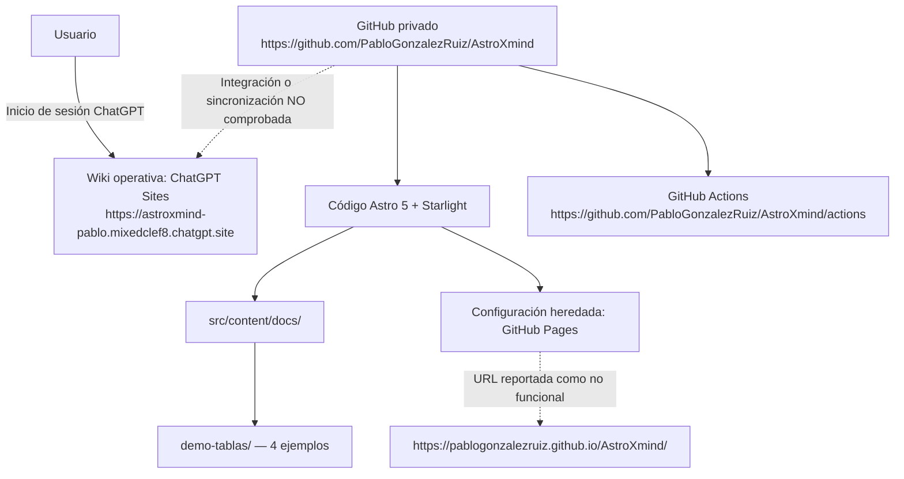

# Mapa de ubicaciones y publicación de AstroXmind

**Fecha de revisión:** 15/11/2026  
**Estado:** documentación de arquitectura y ubicaciones; la relación de despliegue de ChatGPT Sites está **sin verificar**.

## Direcciones y funciones

| Elemento | Ubicación | Estado conocido |
| --- | --- | --- |
| Wiki utilizada por el propietario | https://astroxmind-pablo.mixedclef8.chatgpt.site | El propietario confirma que funciona después de iniciar sesión con ChatGPT. |
| Repositorio fuente | https://github.com/PabloGonzalezRuiz/AstroXmind | Repositorio privado, accesible con permisos de GitHub. |
| Rama de integración | `main` | Contiene el proyecto Astro/Starlight y los ejemplos de tablas. |
| Configuración de Astro | `astro.config.mjs` | Todavía contiene `site: 'https://pablogonzalezruiz.github.io'` y `base: '/AstroXmind'`. |
| Contenido de la wiki Astro | `src/content/docs/` | Páginas Markdown y MDX del repositorio. |
| Laboratorio de tablas | `src/content/docs/demo-tablas/` | Cuatro páginas fuente en GitHub; **no consta** que estén publicadas en ChatGPT Sites. |
| Documentación técnica | `docs/` | Arquitectura, continuidad, hoja de ruta, auditorías. |
| Automatizaciones | `.github/workflows/` | CI, compilaciones y otros flujos de GitHub Actions. |
| Dirección GitHub Pages heredada | https://pablogonzalezruiz.github.io/AstroXmind/ | El propietario indica que **no existe / no funciona**. No usar como URL de la wiki operativa. |

## Diagrama de arquitectura: lo confirmado y lo pendiente

**Interpretación:** la flecha discontinua entre GitHub y ChatGPT Sites **no acredita una integración**. Se desconoce si ChatGPT Sites importa estos archivos, mantiene una copia independiente o utiliza otro sistema de edición.

## Rutas internas de interés

- `src/content/docs/index.mdx`: portada de la versión Astro.
- `src/content/docs/demo-tablas/index.mdx`: índice del laboratorio.
- `src/content/docs/demo-tablas/arbol-vertical.mdx`: tabla árbol vertical plegable.
- `src/content/docs/demo-tablas/arbol-horizontal.mdx`: tabla árbol horizontal.
- `src/content/docs/demo-tablas/comparativa.mdx`: formatos de tablas.
- `astro.config.mjs`: navegación, dominio base y configuración Starlight.
- `package.json`: dependencias y comandos de desarrollo.
- `AGENTS.md`, `docs/00-master-prompt.md`, `docs/09-continuation.md`: instrucciones y continuidad.

## Cómo localizar y comprobar los entornos

1. **Ver la wiki en uso:** abrir ChatGPT Sites e iniciar sesión con ChatGPT. Esta es la única dirección de uso confirmada por el propietario.
2. **Editar o auditar código:** abrir GitHub con la cuenta autorizada, rama `main`, y revisar `src/content/docs/`.
3. **Comprobar compilación:** abrir `https://github.com/PabloGonzalezRuiz/AstroXmind/actions`. Una compilación correcta no prueba que ChatGPT Sites se haya actualizado.
4. **Comprobar publicación:** abrir la URL real de ChatGPT Sites y verificar visualmente el contenido; no inferir publicación a partir de un commit.
5. **Antes de automatizar el despliegue:** identificar el editor, origen de datos y mecanismo de publicación de ChatGPT Sites; documentar la integración y verificarla con un cambio de prueba.

## Decisiones y precauciones

- **No anunciar** GitHub Pages como web operativa mientras no se confirme su funcionamiento.
- **No inventar rutas** de ChatGPT Sites para las páginas de demostración.
- **No asumir** que una fusión en `main` publica cambios en ChatGPT Sites.
- Mantener separados: *código fuente*, *sitio publicado* y *mecanismo de sincronización*.
- Una vez identificada la integración real, actualizar este documento, `README.md` y `astro.config.mjs` si corresponde.

## Pendiente de investigación

- Identificar el proyecto/editor responsable de `astroxmind-pablo.mixedclef8.chatgpt.site`.
- Confirmar si tiene vínculo con este repositorio GitHub.
- Documentar procedimiento autorizado para copiar y publicar los ejemplos en la wiki operativa.
- Comprobar las URL finales de las cuatro páginas en el dominio de ChatGPT Sites.
